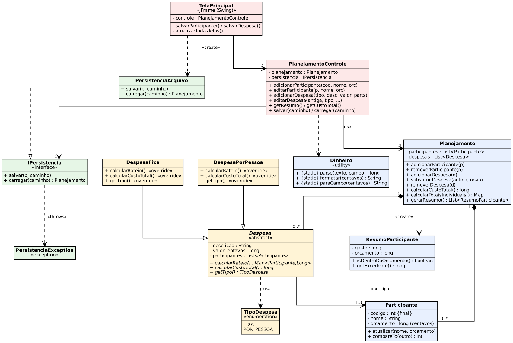

# Cabe no bolso — Planejador de despesas compartilhadas

Aplicação Java (Swing) para planejar despesas de um passeio em grupo: cadastra participantes e despesas,
faz o rateio dos custos, mostra o total de cada pessoa e indica quem está dentro ou acima do orçamento.
Projeto da atividade final de **Programação Orientada a Objetos** (EAD Unifor).

## Requisitos

- **JDK 17 ou superior** (desenvolvido e testado com JDK 21). Só precisa do JDK: **não há dependências externas**.

## Como compilar e executar

Na **raiz do projeto** (a pasta onde está este README):

**Linux / macOS**
```bash
mkdir -p bin
javac -encoding UTF-8 -d bin $(find src -name "*.java")
java -cp bin cabenobolso.Main
```

**Windows (PowerShell)**
```powershell
mkdir bin -Force
javac -encoding UTF-8 -d bin (Get-ChildItem -Recurse -Filter *.java src).FullName
java -cp bin cabenobolso.Main
```

No VS Code também funciona: abra a pasta, o `.vscode/settings.json` já aponta `src` como código-fonte, e execute `Main.java`.

## Como usar

1. **Participantes**: informe código (único), nome e orçamento (ex.: `70,00` ou `70.00`) e clique em *Salvar Participante*.
   Para **editar**, clique na linha da tabela (só nome e orçamento mudam; o código é fixo) e salve. Use *Limpar Campos* para voltar a cadastrar.
2. **Despesas**: descrição, valor, tipo (*Fixa* ou *Por Pessoa*) e participantes envolvidos (Ctrl para vários).
   Para editar, clique na linha da tabela.
3. **Resumo / Status**: custo total, total e situação de cada participante e a lista de despesas.
4. **Gestão de arquivo**: *Novo*, *Salvar* e *Carregar* o planejamento (arquivo `.dat`).

Um arquivo de exemplo com o caso de referência está em [`dados/caso_referencia.dat`](dados/caso_referencia.dat)
(use *Carregar Planejamento*). Para recriá-lo:

```bash
java -cp bin cabenobolso.teste.GeradorDadosExemplo
```

## Regras de negócio implementadas

| Regra | Onde |
|---|---|
| Código de participante único; orçamento ≥ 0 | `Planejamento`, `Participante` |
| Despesa > 0, com ≥ 1 participante cadastrado e sem repetição | `Despesa`, `Planejamento` |
| Despesa **fixa**: valor dividido entre os selecionados; centavos que sobram vão para os menores códigos | `DespesaFixa` |
| Despesa **por pessoa**: valor unitário cobrado de cada selecionado | `DespesaPorPessoa` |
| Quem não participa paga 0,00 | `Planejamento.calcularTotaisIndividuais` |
| Total **igual** ao orçamento = dentro; acima = mostra o valor excedido (e ainda permite salvar) | `ResumoParticipante` |
| Entrada inválida é recusada **sem alterar** o estado anterior | modelo + controlador |
| Não é possível remover participante com despesas vinculadas | `Planejamento.removerParticipante` |
| Totais recalculados após editar/excluir despesas ou alterar orçamentos | cálculo sempre feito sob demanda |
| Dinheiro em **centavos (`long`)**, sem `double` | `Dinheiro` |

## Organização (MVC) e pacotes

```
src/cabenobolso/
├── Main.java                      ponto de entrada
├── modelo/                        MODELO: dados, cálculos e validações
│   ├── Planejamento, Participante
│   ├── Despesa (abstrata), DespesaFixa, DespesaPorPessoa, TipoDespesa
│   ├── ResumoParticipante, Dinheiro
├── controle/PlanejamentoControle  CONTROLADOR: recebe ações da tela, converte e chama o modelo
├── visao/TelaPrincipal            VISÃO (Swing): lê entradas e exibe resultados/mensagens
├── persistencia/                  contrato IPersistencia + PersistenciaArquivo (serialização)
└── teste/                         testes executáveis e gerador do arquivo de exemplo
```

Fluxo de uma ação: botão na **visão** → **controlador** converte o texto digitado → **modelo** valida e calcula →
retorna resultado (ou exceção com mensagem) → **visão** exibe.

### Diagrama de classes



(Código-fonte do diagrama em [`docs/diagrama_classes.dot`](docs/diagrama_classes.dot); gere de novo com `dot -Tpng`.)

### Decisões de POO e justificativas

- **Encapsulamento**: todos os atributos são `private`; as listas do `Planejamento` são devolvidas como visões somente leitura;
  o código do participante é `final`; `Participante.atualizar` valida tudo antes de gravar (tudo ou nada).
- **Herança e polimorfismo**: `Despesa` é abstrata; `DespesaFixa` e `DespesaPorPessoa` sobrescrevem `calcularRateio()`,
  `calcularCustoTotal()` e `getTipo()`. O `Planejamento` trabalha apenas com `List<Despesa>` e nunca precisa de `instanceof`.
- **Interface de persistência**: `IPersistencia` define `salvar`/`carregar`; `PersistenciaArquivo` implementa;
  o controlador depende **só da interface** (a implementação é injetada no construtor).
- **Coleções genéricas**:
  - `List<Participante>` e `List<Despesa>` no planejamento: mantêm a ordem de cadastro e permitem editar por posição.
  - `TreeMap<Participante, Long>` nos rateios e totais: ordena automaticamente pelo código (`Comparable`),
    o que dá resultados em ordem previsível e facilita a distribuição dos centavos.
  - `List<Participante>` sem repetição e ordenada por código dentro de cada despesa.
- **Exceções**: o modelo lança `IllegalArgumentException` (entrada inválida) e `IllegalStateException` (regra violada);
  a persistência lança `PersistenciaException` com mensagem pensada para o usuário.
- **Serialização**: classes do modelo implementam `Serializable` com `serialVersionUID`; fluxos fechados com `try-with-resources`;
  gravação em arquivo temporário seguida de substituição (não corrompe o arquivo anterior); leitura com filtro
  (`ObjectInputFilter`) que só aceita as classes do modelo e tipos básicos do Java.

## Testes

Os testes cobrem o **caso de referência** (seção 4 do enunciado), os **6 testes adicionais** e alguns testes extras de robustez.
Cada verificação imprime **entrada, esperado, obtido** e o resultado `OK`/`FALHOU` (sem precisar de JUnit):

```bash
java -cp bin cabenobolso.teste.TestesCasoReferencia
```

No Windows, se os acentos saírem estranhos, rode antes `chcp 65001`.
A saída completa da última execução está em [`docs/resultado_testes.txt`](docs/resultado_testes.txt).

| # | Cenário | Verificado em |
|---|---|---|
| — | Caso de referência (75 / 60 / 75; total 210; Ana e Carla excedem R$ 5,00) | `casoReferencia()` |
| 1 | Centavos no rateio (33,34 / 33,33 / 33,33) | `teste1CentavosNoRateio()` |
| 2 | Entrada ou vínculo inválido | `teste2EntradaOuVinculoInvalido()` |
| 3 | Alteração de orçamento (Ana → 80,00) | `teste3AlteracaoDeOrcamento()` |
| 4 | Exclusão de despesa (60,00 cada; 180,00 total) | `teste4ExclusaoDeDespesa()` |
| 5 | Salvar e reiniciar | `teste5SalvarEReiniciar()` |
| 6 | Problema no arquivo (ausente / inválido) | `teste6ProblemaNoArquivo()` |

## Observações

- Os valores são digitados com vírgula ou ponto nos centavos, **sem separador de milhar** (ex.: `1500,00`, não `1.500,00`).
- Arquivos `.dat` salvos por versões anteriores do projeto (que usavam `double`) **não são compatíveis** com esta versão.
